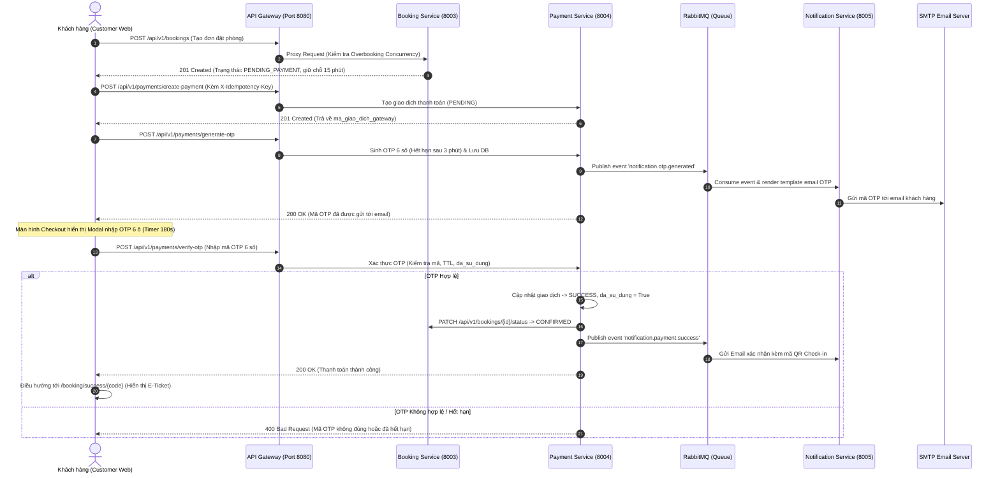

# 🏆 KẾ HOẠCH HÀNH ĐỘNG CHI TIẾT: ĐẠT ĐIỂM 10/10 THEO RUBRIC
## Môn học: Kiến Trúc Hướng Dịch Vụ (504070) – ĐH Tôn Đức Thắng
**Dự án**: `System-Booking-service` (Hệ thống Quản lý & Đặt phòng Khách sạn Trực tuyến)

---

## 📌 I. PHÂN TÍCH KHOẢNG TRỐNG (GAP ANALYSIS) ĐỐI CHIẾU VỚI RUBRIC

### 1. Bảng đối chiếu 8 tiêu chí chấm điểm và hiện trạng

| Tiêu chí | Trọng số | Yêu cầu trong Rubric | Hiện trạng dự án | Khoảng cách cần bổ sung để đạt điểm tối đa |
| :--- | :---: | :--- | :--- | :--- |
| **1. Phân tích nghiệp vụ & UML** | **1.0 đ** | • Use Case Diagram đúng actor & chức năng chính (0.5đ)<br>• ERD xác định hợp lý entity, quan hệ (0.5đ) | • Đã có `ERD.drawio`<br>• **Chưa có Use Case Diagram chuẩn UML** | Bổ sung file sơ đồ `docs/Use_Case_Diagram.drawio` & file ảnh PNG. |
| **2. Kiến trúc Microservices** | **1.5 đ** | • Microservices Architecture Diagram rõ ràng (0.5đ)<br>• Phân rã hợp lý, rõ trách nhiệm từng service (0.5đ)<br>• Giao tiếp service, database, external service (0.5đ) | • 6 backend services + Gateway + RabbitMQ + DB riêng biệt.<br>• **Chưa có file sơ đồ kiến trúc độc lập trong docs** | Tạo file `docs/Microservices_Architecture_Diagram.drawio` và ảnh PNG. *(Tránh trần 8.0)*. |
| **3. Thiết kế REST API** | **1.0 đ** | • Đầy đủ API, URI và HTTP Method hợp lý (0.5đ)<br>• Request/Response model, Status Code, validation (0.5đ) | • Chuẩn RESTful, Pydantic DTO chặt chẽ, Swagger UI đầy đủ | Bổ sung DTO và API cho module OTP & Idempotency. |
| **4. Database & Data Persistence** | **1.0 đ** | • Database phù hợp thiết kế, đủ dữ liệu (0.5đ)<br>• Ràng buộc, validation, dữ liệu mẫu hoạt động đúng (0.5đ) | • 6 CSDL MSSQL riêng biệt, constraints, seed data tự động | Bổ sung bảng `giao_dich_otp` trong database `payment_service`. |
| **5. Hiện thực chức năng & Payment Workflow** | **2.0 đ** | • Đăng nhập, thông tin tài khoản, tra cứu (0.5đ)<br>• Khởi tạo & thực hiện giao dịch, kiểm tra đơn (0.5đ)<br>• **OTP sinh ra, gắn giao dịch, có TTL, dùng 1 lần, gửi email (0.5đ)**<br>• Thanh toán thành công cập nhật trạng thái, lưu lịch sử, gửi email (0.5đ) | • Đăng nhập, tra cứu, tạo booking, thanh toán Sandbox: ĐẠT.<br>• **THIẾU HOÀN TOÀN QUY TRÌNH XÁC THỰC OTP QUA EMAIL (0.5đ)** | **BẮT BUỘC**: Hiện thực đầy đủ API sinh OTP, lưu DB, bắn RabbitMQ gửi email HTML, và API verify OTP. *(Tránh trần 7.0)*. |
| **6. Transaction & Concurrency** | **1.5 đ** | • Giao dịch đảm bảo nhất quán dữ liệu liên quan (0.5đ)<br>• Xử lý nhiều giao dịch đồng thời không vượt hạn mức (0.5đ)<br>• Xử lý tranh chấp cùng thanh toán / cùng đặt 1 tài nguyên (0.5đ) | • Đã có logic check trùng ngày trả lời `409 Conflict`.<br>• **Chưa có script test concurrency tự động để demo** | **BẮT BUỘC**: Viết bộ script test đa luồng `test_concurrency_booking.py` và `test_concurrency_payment.py`. |
| **7. User Interface & Integration** | **0.5 đ** | • Giao diện hỗ trợ toàn bộ luồng: Đăng nhập → Tra cứu → Đặt chỗ → Thanh toán → **OTP** → E-Ticket / Lịch sử | • Web Next.js 16 rất đẹp, tích hợp Gateway.<br>• **Thiếu Modal nhập mã OTP khi checkout** | Bổ sung Modal OTP Component trên giao diện checkout của `customer-web`. |
| **8. Documentation, Deployment & Demo** | **1.5 đ** | • README/hướng dẫn cài đặt, cấu hình (0.5đ)<br>• Chạy hoàn chỉnh qua Docker Compose (0.5đ)<br>• Demo thành công các chức năng và giải thích kiến trúc (0.5đ) | • README và script PowerShell xuất sắc.<br>• Docker Compose chạy đầy đủ | Chuẩn bị kịch bản demo (Cheat Sheet) cho buổi bảo vệ. |

---

### 2. Các điều kiện giới hạn điểm & Yêu cầu kỹ thuật mức 10.0

> [!CAUTION]
> **CÁC ĐIỀU KIỆN GIỚI HẠN ĐIỂM (HARD CAPS - TRANG 3):**
> 1. **Không hiện thực quy trình xác thực OTP $\rightarrow$ Điểm tối đa: 7.0**
> 2. **Không có giải pháp xử lý Transaction/Concurrency $\rightarrow$ Điểm tối đa: 7.5**
> 3. **Không có Microservices Architecture Diagram $\rightarrow$ Điểm tối đa: 8.0**

> [!IMPORTANT]
> **YÊU CẦU ĐỂ ĐẠT MỨC ĐIỂM 10.0 TUYỆT ĐỐI (TRANG 3):**
> - Kiến trúc, implementation, testing và deployment nhất quán.
> - **Giải pháp nâng cao**:
>   1. **Concurrency test đa luồng (Automated Multithreading Test)**
>   2. **Integration / E2E test toàn luồng**
>   3. **Idempotency (Tránh thanh toán đúp bằng `X-Idempotency-Key`)**
>   4. **API Gateway tập trung & Logging / Tracing (`X-Correlation-ID`)**

---

## 🏗️ II. KIẾN TRÚC GIẢI PHÁP TỔNG THỂ (TO-BE ARCHITECTURE)



---

## 🚀 III. LỘ TRÌNH TRIỂN KHAI CHI TIẾT (6 GIAI ĐOẠN)

### GIAI ĐOẠN 1: Hiện thực Module OTP Hoàn Chỉnh (Backend Engine)
**Mục tiêu**: Xóa bỏ rào cản chặn trần 7.0 điểm.

#### 1.1. Khởi tạo bảng CSDL `giao_dich_otp` trong `payment_service`
Thêm vào file `services/payment-service/database_init.sql` và thực thi trên database:
```sql
USE payment_service;
GO

IF NOT EXISTS (SELECT * FROM sys.tables WHERE name = 'giao_dich_otp')
BEGIN
    CREATE TABLE giao_dich_otp (
        id_otp INT IDENTITY(1,1) PRIMARY KEY,
        ma_giao_dich_gateway NVARCHAR(100) NOT NULL,
        email NVARCHAR(150) NOT NULL,
        otp_code NVARCHAR(6) NOT NULL,
        thoi_gian_tao DATETIME NOT NULL DEFAULT GETDATE(),
        thoi_gian_het_han DATETIME NOT NULL,
        da_su_dung BIT NOT NULL DEFAULT 0,
        so_lan_thu INT NOT NULL DEFAULT 0,
        CONSTRAINT fk_otp_thanh_toan FOREIGN KEY (ma_giao_dich_gateway)
            REFERENCES thanh_toan(ma_giao_dich_gateway) ON DELETE CASCADE
    );

    CREATE INDEX idx_otp_txn ON giao_dich_otp(ma_giao_dich_gateway);
    CREATE INDEX idx_otp_code ON giao_dich_otp(otp_code);
END
GO
```

#### 1.2. Tạo ORM Model `giao_dich_otp.py` trong `payment-service`
Tạo file: `services/payment-service/src/models/giao_dich_otp.py`
- Định nghĩa các cột: `id_otp`, `ma_giao_dich_gateway`, `email`, `otp_code`, `thoi_gian_tao`, `thoi_gian_het_han`, `da_su_dung`, `so_lan_thu`.

#### 1.3. Bổ sung Pydantic Schemas trong `payment_schema.py`
```python
class GenerateOtpRequest(BaseModel):
    ma_giao_dich_gateway: str
    email: EmailStr

class VerifyOtpRequest(BaseModel):
    ma_giao_dich_gateway: str
    otp_code: str = Field(..., min_length=6, max_length=6)

class OtpResponse(BaseModel):
    success: bool
    message: str
    ma_giao_dich_gateway: str
    expires_in_seconds: Optional[int] = None
```

#### 1.4. Xử lý nghiệp vụ tại `payment_service.py`
- **`generate_otp()`**:
  - Kiểm tra giao dịch tồn tại và đang `PENDING`.
  - Hủy hiệu lực các OTP cũ của giao dịch này (nếu có).
  - Sinh mã ngẫu nhiên 6 số (`random.randint(100000, 999999)`).
  - Đặt thời hạn 3 phút (`now + timedelta(minutes=3)`).
  - Lưu vào CSDL.
  - Bắn sự kiện RabbitMQ `notification.otp.generated` (hoặc REST fallback sang Notification Service).
- **`verify_otp()`**:
  - Truy vấn OTP mới nhất theo `ma_giao_dich_gateway`.
  - Kiểm tra `da_su_dung == 0`, `now <= thoi_gian_het_han`, `so_lan_thu < 3`.
  - Nếu sai mã: tăng `so_lan_thu += 1`, commit DB và ném `HTTP 400 Bad Request`.
  - Nếu đúng mã: đánh dấu `da_su_dung = 1`, cập nhật giao dịch sang `SUCCESS`.
  - Gọi đồng bộ sang Booking Service cập nhật đơn hàng sang `CONFIRMED`.
  - Bắn event RabbitMQ `notification.booking.confirmed` gửi vé điện tử.

#### 1.5. Cập nhật Notification Service Email Template
- File `services/notification-service/src/core/templates.py`:
  - Thêm hàm `render_otp_email(data)`: Tạo email HTML sang trọng chứa mã OTP 6 số khổ lớn, cảnh báo hết hạn 3 phút và hướng dẫn bảo mật.
- File `services/notification-service/src/core/rabbitmq_consumer.py`:
  - Lắng nghe thêm queue `notification.otp.generated`.

---

### GIAI ĐOẠN 2: Hiện thực Idempotency & Concurrency Protection
**Mục tiêu**: Đạt trọn vẹn điểm Tiêu chí 6 và giải pháp nâng cao mức 10.0.

#### 2.1. Idempotency Key Middleware / Header cho Payment Service
- Tại endpoint `POST /api/v1/payments/create-payment`:
  - Nhận Header tuỳ chọn: `X-Idempotency-Key: str`.
  - Bảng `thanh_toan` bổ sung cột `idempotency_key NVARCHAR(100) NULL UNIQUE`.
  - Nếu request gửi lại cùng `idempotency_key` $\rightarrow$ Trả về ngay giao dịch cũ mà không tạo thêm bản ghi mới.

#### 2.2. Khóa chống thanh toán đúp (Double-Payment Concurrency Guard)
- Khi gọi `verify-otp` hoặc `simulate-ipn`:
  - Sử dụng Transaction với cờ kiểm tra nguyên tử:
    ```python
    txn = db.query(ThanhToanModel).filter(
        ThanhToanModel.ma_giao_dich_gateway == payload.ma_giao_dich_gateway
    ).with_for_update().first()

    if txn.trang_thai == "SUCCESS":
        raise HTTPException(status_code=400, detail="Giao dịch này đã được thanh toán thành công trước đó.")
    ```

---

### GIAI ĐOẠN 3: Tích Hợp Giao Diện Checkout (Frontend Modal OTP)
**Mục tiêu**: Đáp ứng trọn vẹn Tiêu chí 7 (0.5đ giao diện toàn luồng).

#### 3.1. Cập nhật `@repo/types` và `@repo/api-client`
- Thêm types: `GenerateOtpRequest`, `VerifyOtpRequest`, `OtpResponse`.
- Thêm methods trong `ApiClient`:
  - `generatePaymentOtp(data: GenerateOtpRequest): Promise<OtpResponse>`
  - `verifyPaymentOtp(data: VerifyOtpRequest): Promise<PaymentResponse>`

#### 3.2. Nâng cấp trang Checkout (`front-end/apps/customer-web/src/app/booking/checkout/page.tsx`)
- Thêm State:
  ```typescript
  const [showOtpModal, setShowOtpModal] = useState(false);
  const [otpCode, setOtpCode] = useState(["", "", "", "", "", ""]);
  const [otpCountdown, setOtpCountdown] = useState(180);
  const [currentTxnCode, setCurrentTxnCode] = useState("");
  ```
- **Luồng người dùng**:
  1. Người dùng bấm "Xác nhận & Thanh toán".
  2. Frontend gọi `createBookingOrder` $\rightarrow$ `createPayment` $\rightarrow$ `generatePaymentOtp`.
  3. Mở **Modal Xác Thực OTP**:
     - 6 ô input tự động nhảy focus khi gõ số.
     - Hiển thị đồng hồ đếm ngược 180s.
     - Nút "Gửi lại mã OTP" khi hết giờ.
     - Thông báo email đã nhận mã.
  4. Người dùng nhập đủ 6 số $\rightarrow$ Tự động gọi `verifyPaymentOtp`.
  5. Thành công: Chuyển hướng sang `/booking/success/[code]`.

---

### GIAI ĐOẠN 4: Distributed Tracing qua API Gateway
**Mục tiêu**: Tiêu chí logging/tracing mức 10.0.

#### 4.1. Bổ sung `X-Correlation-ID` Middleware tại Gateway
- Trong `gateway/src/main.py`:
  - Mỗi request tới Gateway sẽ được kiểm tra: nếu chưa có header `X-Correlation-ID`, sinh mới bằng `str(uuid.uuid4())`.
  - Forward header này tới tất cả microservices downstream.
  - Đính kèm header `X-Correlation-ID` vào HTTP Response trả về cho Client.
  - Ghi log định dạng: `[CORRELATION_ID: {cid}] {method} {path} -> {status}`.

---

### GIAI ĐOẠN 5: Xây Dựng Bộ Script Test Tự Động (Concurrency & E2E)
**Mục tiêu**: Cung cấp bằng chứng thực nghiệm rõ ràng nhất để thuyết phục giảng viên cho điểm 10.0 tuyệt đối.

Tạo 3 script Python chuyên dụng trong thư mục `test/`:

#### 5.1. `test/test_concurrency_overbooking.py` (Kịch bản 1: Tranh chấp phòng đồng thời)
- Sử dụng `concurrent.futures.ThreadPoolExecutor(max_workers=5)`.
- Bắn đồng thời 5 requests cùng đặt phòng `P.101` cho cùng 1 khoảng thời gian.
- **Kỳ vọng đầu ra**:
  - 1 request phản hồi `HTTP 201 Created` (Thành công giữ chỗ).
  - 4 requests còn lại phản hồi `HTTP 409 Conflict` ("Phòng đã có người đặt trong thời gian này").

#### 5.2. `test/test_concurrency_payment.py` (Kịch bản 2: Tranh chấp thanh toán lặp)
- Bắn đồng thời 2 request xác thực OTP/thanh toán trên cùng 1 mã giao dịch.
- **Kỳ vọng đầu ra**:
  - 1 request thành công `HTTP 200 SUCCESS`.
  - 1 request bị từ chối `HTTP 400 Bad Request` ("Giao dịch đã được thanh toán hoặc mã OTP đã sử dụng").

#### 5.3. `test/test_e2e_full_flow.py` (Kịch bản E2E toàn diện qua Gateway 8080)
- Tự động chạy tuần tự:
  1. `POST /api/v1/auth/login` (Lấy JWT Token).
  2. `GET /api/v1/rooms/available` (Tìm phòng trống).
  3. `POST /api/v1/bookings` (Tạo đơn đặt phòng).
  4. `POST /api/v1/payments/create-payment` (Khởi tạo thanh toán).
  5. `POST /api/v1/payments/generate-otp` (Sinh mã OTP).
  6. `POST /api/v1/payments/verify-otp` (Xác thực OTP & chốt đơn).
  7. `GET /api/v1/notifications?booking_code=...` (Kiểm tra email thông báo & mã QR).

---

### GIAI ĐOẠN 6: Bổ Sung Sơ Đồ Thiết Kế & Soạn Cheat Sheet Demo
**Mục tiêu**: Đạt trọn vẹn điểm Tiêu chí 1, 2 và bảo vệ thành công trước Hội đồng chấm thi.

#### 6.1. Thiết kế sơ đồ trong thư mục `docs/`
1. `docs/Use_Case_Diagram.drawio`:
   - Actor: **Customer** (Tìm kiếm, Xem chi tiết, Đặt phòng, Nhận OTP, Thanh toán, Xem E-ticket, Hủy đơn).
   - Actor: **Partner** (Quản lý khách sạn, Thêm loại phòng, Quản lý trạng thái phòng).
   - Actor: **Admin** (Quản lý người dùng, Khóa tài khoản, Duyệt khách sạn, Thống kê dòng tiền).
   - Actor: **Payment Gateway / SMTP Server** (Xử lý giao dịch, Gửi email).
2. `docs/Microservices_Architecture_Diagram.drawio`:
   - Phân tầng trực quan: Client Layer $\rightarrow$ Gateway Layer $\rightarrow$ Service Mesh Layer $\rightarrow$ Event Bus $\rightarrow$ Multi-Database Layer.

#### 6.2. Soạn Cheat Sheet hướng dẫn Demo cho nhóm
- Bộ câu hỏi giảng viên thường hỏi và câu trả lời mẫu:
  - *Câu hỏi*: "Hệ thống làm sao đảm bảo không bị Overbooking khi 2 người cùng bấm đặt phòng tại cùng 1 giây?"
  - *Trả lời*: Trình bày cơ chế Hold 15 phút + thuật toán giao thoa ngày trong Booking Service + chạy trực tiếp script `test_concurrency_overbooking.py`.
  - *Câu hỏi*: "Tại sao dùng RabbitMQ mà không gọi REST API thẳng sang Notification Service?"
  - *Trả lời*: Bất đồng bộ hóa (asynchronous processing), tách rời phụ thuộc (loose coupling), chống nghẽn đường truyền và có sẵn cơ chế Fallback REST nếu message broker gặp sự cố.

---

## 📅 BẢNG PHÂN CÔNG & THỜI GIAN BIỂU TRIỂN KHAI

| Hạng mục công việc | File mã nguồn tác động chính | Trọng số & Mục tiêu |
| :--- | :--- | :---: |
| **1. Bảng CSDL & Model OTP** | [`payment-service/database_init.sql`](file:///d:/System-Booking-service/services/payment-service/database_init.sql)<br>`src/models/giao_dich_otp.py` | Phá vỡ trần 7.0 |
| **2. API Sinh & Xác thực OTP** | [`payment-service/src/services/payment_service.py`](file:///d:/System-Booking-service/services/payment-service/src/services/payment_service.py)<br>[`payment-service/src/api/v1/endpoints/payments.py`](file:///d:/System-Booking-service/services/payment-service/src/api/v1/endpoints/payments.py) | Tiêu chí 5 (2.0đ) |
| **3. Email Template OTP** | [`notification-service/src/core/templates.py`](file:///d:/System-Booking-service/services/notification-service/src/core/templates.py)<br>[`notification-service/src/core/rabbitmq_consumer.py`](file:///d:/System-Booking-service/services/notification-service/src/core/rabbitmq_consumer.py) | Event-Driven OTP |
| **4. Idempotency & Double Payment Guard** | [`payment-service/src/services/payment_service.py`](file:///d:/System-Booking-service/services/payment-service/src/services/payment_service.py) | Tiêu chí 6 (1.5đ) |
| **5. Correlation ID Tracing** | [`gateway/src/main.py`](file:///d:/System-Booking-service/gateway/src/main.py) | Tiêu chí mức 10.0 |
| **6. Giao diện Modal OTP Checkout** | [`customer-web/src/app/booking/checkout/page.tsx`](file:///d:/System-Booking-service/front-end/apps/customer-web/src/app/booking/checkout/page.tsx)<br>[`api-client/src/index.ts`](file:///d:/System-Booking-service/front-end/packages/api-client/src/index.ts) | Tiêu chí 7 (0.5đ) |
| **7. Bộ Script Automated Concurrency Test** | `test/test_concurrency_overbooking.py`<br>`test/test_concurrency_payment.py`<br>`test/test_e2e_full_flow.py` | Bằng chứng mức 10.0 |
| **8. Sơ đồ UML & Kiến trúc** | `docs/Use_Case_Diagram.drawio`<br>`docs/Microservices_Architecture_Diagram.drawio` | Tiêu chí 1, 2 (2.5đ) |

---

## 🎯 KẾT QUẢ KỲ VỌNG
Sau khi hoàn thành đầy đủ 8 hạng mục trên:
1. **Không còn bất kỳ điều kiện giới hạn trần điểm nào vi phạm** (Đã có OTP, đã có Concurrency, đã có Architecture Diagram).
2. **Đáp ứng toàn bộ tiêu chí mức 10.0**: Có API Gateway, E2E test, Concurrency test, Idempotency, Tracing, UI hoàn chỉnh, Docker Compose nhất quán.
3. **Điểm số mục tiêu: 10.0 / 10.0.**
