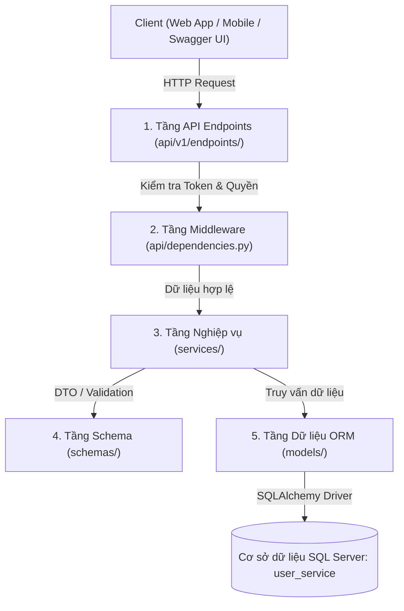
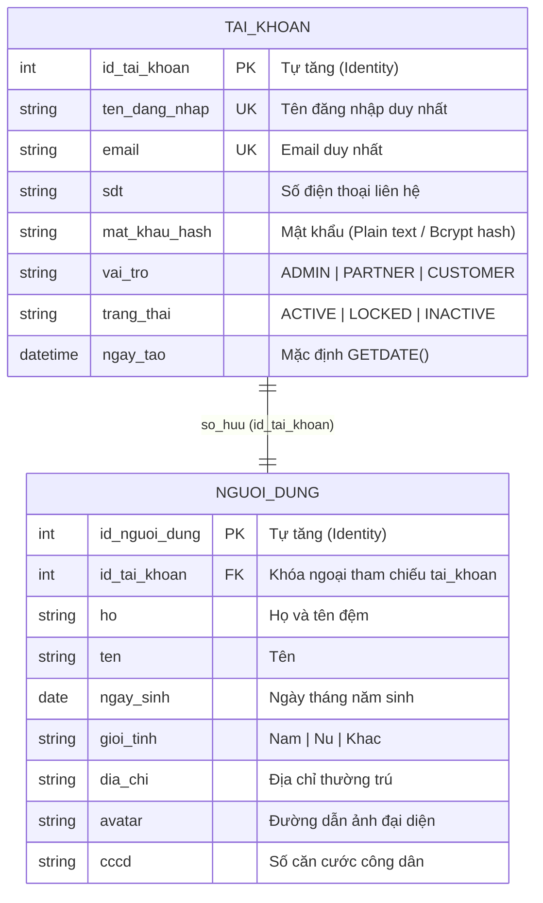
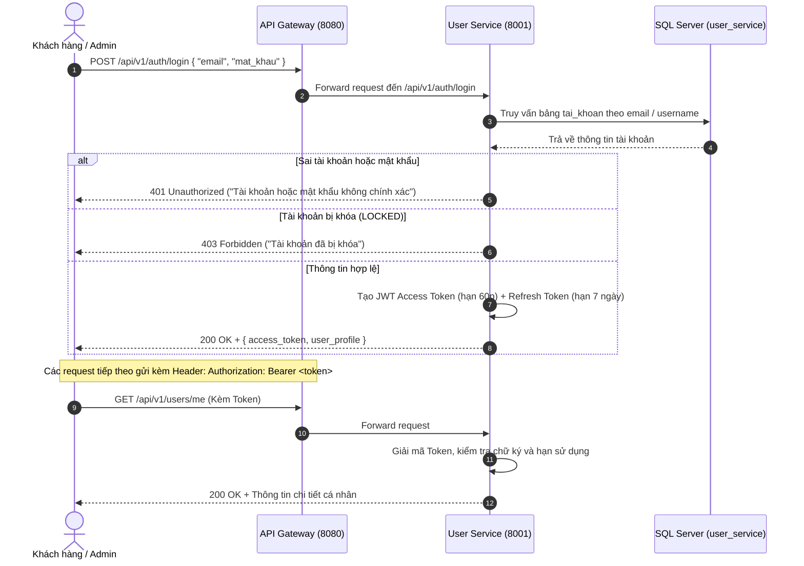

# 👤 BÁO CÁO KIẾN TRÚC & SƠ ĐỒ CẤU TRÚC: USER-SERVICE

Microservice **User Service** là thành phần cốt lõi đảm nhiệm vai trò **Quản lý Danh tính & Phân quyền (Identity and Access Management - IAM)** trong hệ thống đặt phòng khách sạn trực tuyến theo kiến trúc Microservices / SOA.

---

## 🌳 1. SƠ ĐỒ CÂY THƯ MỤC CHI TIẾT (DIRECTORY STRUCTURE)

```text
services/user-service/
├── src/
│   ├── main.py                   # 🚀 Khởi chạy ứng dụng FastAPI, cấu hình CORS, vòng đời lifespan, auto-seed DB
│   ├── api/                      # 🌐 Tầng giao tiếp mạng (HTTP API Layer)
│   │   ├── dependencies.py       # 🛡️ Middleware bảo vệ: Giải mã JWT, kiểm tra tài khoản khóa, phân quyền Admin/Partner
│   │   └── v1/
│   │       ├── router.py         # Gom cụm các router con của phiên bản API v1
│   │       └── endpoints/
│   │           ├── auth.py       # API Đăng ký, Đăng nhập, Cấp mới Access Token (/api/v1/auth)
│   │           ├── users.py      # API Xem và Sửa hồ sơ cá nhân của tài khoản (/api/v1/users)
│   │           └── admin.py      # API Quản trị viên: Xem toàn bộ người dùng, Khóa/Mở khóa tài khoản (/api/v1/admin)
│   ├── core/                     # ⚙️ Cấu hình cốt lõi & Tiện ích bảo mật hệ thống
│   │   ├── config.py             # Quản lý biến môi trường (.env): Port 8001, chuỗi kết nối SQL Server, JWT Secret
│   │   ├── database.py           # Thiết lập kết nối SQLAlchemy: Engine, SessionLocal, Dependency get_db
│   │   └── security.py           # Mã hóa & Xác thực: Tạo JWT Token, Giải mã Token, So sánh mật khẩu
│   ├── models/                   # 🗄️ Ánh xạ Cơ sở dữ liệu (SQLAlchemy ORM Entities)
│   │   ├── tai_khoan.py          # Bảng 'tai_khoan': ID, username, email, password, vai trò, trạng thái
│   │   └── nguoi_dung.py         # Bảng 'nguoi_dung': Họ tên, ngày sinh, giới tính, địa chỉ, avatar, CCCD (1:1 với tai_khoan)
│   ├── schemas/                  # 📋 Định nghĩa cấu trúc dữ liệu đầu vào / đầu ra (Pydantic DTO)
│   │   ├── auth_schema.py        # Schema: RegisterRequest, LoginRequest, TokenResponse, RefreshTokenRequest
│   │   └── user_schema.py        # Schema: TaiKhoanResponse, NguoiDungUpdate, UserStatusUpdate, UserPaginatedResponse
│   └── services/                 # 🧠 Tầng xử lý nghiệp vụ chính (Business Logic Layer)
│       ├── auth_service.py       # Xử lý logic nghiệp vụ đăng ký (chống trùng lặp), đăng nhập, cấp phát JWT
│       └── user_service.py       # Xử lý xem profile, cập nhật thông tin cá nhân, truy vấn và khóa tài khoản
├── database_init.sql             # 📜 Script T-SQL khởi tạo CSDL 'user_service', tạo bảng và dữ liệu mẫu
├── Dockerfile                    # 🐳 File đóng gói container Docker cho User Service
├── requirements.txt              # 📦 Danh sách thư viện Python cần thiết (FastAPI, SQLAlchemy, PyODBC, PyJWT...)
└── .env.example                  # 📝 Mẫu cấu hình biến môi trường cục bộ
```

---

## 🏛️ 2. KIẾN TRÚC PHÂN TẦNG (LAYERED ARCHITECTURE)

Hệ thống được thiết kế theo mô hình 4 tầng tách biệt rõ ràng nhằm đảm bảo tính độc lập và khả năng bảo trì cao:



| Tầng kiến trúc | Thư mục mã nguồn | Trách nhiệm chính |
| :--- | :--- | :--- |
| **API Endpoints** | `src/api/v1/endpoints/` | Tiếp nhận HTTP Request, gọi tầng Service và trả HTTP Response về client. |
| **Middleware & Guards** | `src/api/dependencies.py` | Người gác cổng: Chặn request không có JWT token, token hết hạn hoặc tài khoản bị `LOCKED`. |
| **Business Logic** | `src/services/` | Nơi tập trung toàn bộ logic nghiệp vụ (kiểm tra email trùng, cấp token, khóa user). |
| **Data Models (ORM)** | `src/models/` | Đại diện cho các bảng dữ liệu trong SQL Server bằng các Python Class của SQLAlchemy. |
| **Data Schemas (DTO)** | `src/schemas/` | Kiểm tra tính hợp lệ của dữ liệu đầu vào (Request body) và format dữ liệu trả ra (Response JSON). |
| **Core Utilities** | `src/core/` | Cung cấp kết nối CSDL, quản lý cấu hình và tiện ích mã hóa bảo mật. |

---

## 🗄️ 3. SƠ ĐỒ THỰC THỂ CƠ SỞ DỮ LIỆU (ERD)

User Service sở hữu riêng một cơ sở dữ liệu độc lập tên là **`user_service`** trên Microsoft SQL Server. Mô hình bao gồm 2 bảng quan hệ 1:1:



---

## 🔐 4. QUY TRÌNH XÁC THỰC & ĐĂNG NHẬP JWT (SEQUENCE FLOW)



---

## 📡 5. DANH MỤC CÁC ENDPOINT API CUNG CẤP

Cổng dịch vụ: **`http://localhost:8001`** (hoặc gọi qua API Gateway: **`http://localhost:8080/api/v1`**)

| Nhóm chức năng | Phương thức | Đường dẫn API | Quyền truy cập | Mô tả chức năng |
| :--- | :---: | :--- | :---: | :--- |
| **Xác thực & Phân quyền** | `POST` | `/api/v1/auth/register` | Public | Đăng ký tài khoản mới (vai trò `CUSTOMER` hoặc `PARTNER`) |
| | `POST` | `/api/v1/auth/login` | Public | Đăng nhập hệ thống, cấp cặp JWT Access Token và Refresh Token |
| | `POST` | `/api/v1/auth/refresh` | Public | Cấp mới Access Token bằng Refresh Token mà không cần đăng nhập lại |
| **Quản lý Hồ sơ cá nhân** | `GET` | `/api/v1/users/me` | Đăng nhập | Lấy thông tin tài khoản và profile của người đang đăng nhập |
| | `PUT` | `/api/v1/users/me` | Đăng nhập | Cập nhật hồ sơ cá nhân: Họ tên, ngày sinh, SĐT, địa chỉ, CCCD |
| | `GET` | `/api/v1/users/{user_id}` | Đăng nhập | Tra cứu thông tin hồ sơ của một người dùng theo ID |
| **Quản trị hệ thống (Admin)** | `GET` | `/api/v1/admin/users` | `ADMIN` | Xem danh sách tất cả tài khoản, tìm kiếm theo ID hoặc từ khóa, lọc theo role |
| | `GET` | `/api/v1/admin/users/{user_id}` | `ADMIN` | Tra cứu chi tiết tài khoản và toàn bộ hồ sơ của người dùng theo ID |
| | `PATCH` | `/api/v1/admin/users/{id}/status` | `ADMIN` | Khóa tài khoản vi phạm (`LOCKED`) hoặc Mở khóa lại (`ACTIVE`) |
| **Giám sát trạng thái** | `GET` | `/` | Public | Health check trạng thái hoạt động của User Service |

---

## 🔑 6. CÁC TÀI KHOẢN MẪU KHỞI TẠO SẴN

| Vai trò (Role) | Email đăng nhập | Tên đăng nhập | Mật khẩu mặc định | Mục đích sử dụng |
| :--- | :--- | :--- | :---: | :--- |
| **ADMIN** | `admin@hotel.com` | `admin` | `123456` | Đăng nhập trang Admin Dashboard quản trị toàn bộ hệ thống |
| **PARTNER** | `partner@hotel.com` | `partner1` | `123456` | Đối tác đăng khách sạn, tạo phòng và quản lý lưu trú |
| **CUSTOMER** | `customer@gmail.com` | `customer1` | `123456` | Khách hàng đặt phòng trực tuyến trên Customer Web App |

---

## 🛠️ 7. HƯỚNG DẪN KHỞI CHẠY & TEST DỊCH VỤ

### Chạy độc lập Service:
```powershell
cd services/user-service
python -m uvicorn src.main:app --reload --port 8001
```

### Truy cập tài liệu tương tác:
- **Swagger UI**: [http://localhost:8001/docs](http://localhost:8001/docs)
- **ReDoc**: [http://localhost:8001/redoc](http://localhost:8001/redoc)
- **Health check**: [http://localhost:8001/](http://localhost:8001/)
