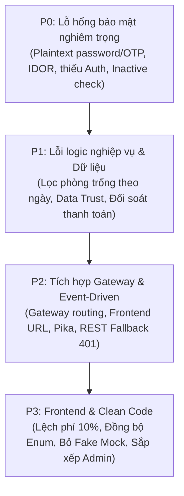

# Kế Hoạch Cải Tiến Hệ Thống (System-Booking-service)

Tài liệu này tổng hợp toàn bộ các đầu việc cải tiến cần thực hiện dựa trên kết quả phân tích tại [DANH_GIA_MUC_DO_HOAN_THIEN.md](file:///d:/System-Booking-service/tmp/DANH_GIA_MUC_DO_HOAN_THIEN.md) và [PROJECT_REVERSE_ENGINEERING_REPORT.md](file:///d:/System-Booking-service/tmp/PROJECT_REVERSE_ENGINEERING_REPORT.md). Các nhiệm vụ được sắp xếp theo 4 cấp độ ưu tiên nghiêm ngặt từ **P0** đến **P3**.

---

## 🧭 Ma trận tổng hợp mức độ ưu tiên

---

## 🔴 P0: Lỗ Hổng Bảo Mật Nghiêm Trọng (Critical Security Vulnerabilities)

> [!CAUTION]
> Các lỗ hổng P0 trực tiếp đe dọa an toàn dữ liệu người dùng, cho phép chiếm đoạt tài khoản hoặc can thiệp dữ liệu trái phép. Cần thực hiện đầu tiên trước khi triển khai bất kỳ tính năng nào khác.

### Task P0.1: Kích hoạt lại băm mật khẩu Bcrypt trong User Service
- **Hiện trạng:** Hàm `hash_password` trong [security.py](file:///d:/System-Booking-service/services/user-service/src/core/security.py#L7-L14) đang comment bcrypt và trả về plain text thô (`return password`). Mật khẩu lưu dạng văn bản thuần trong CSDL.
- **Giải pháp:**
  - Bật lại `bcrypt.hashpw` với salt 12 rounds khi tạo/đổi mật khẩu.
  - Sử dụng `bcrypt.checkpw` trong `verify_password`, duy trì fallback so sánh chuỗi để tương thích các tài khoản seed cũ chưa băm.
- **Checklist file cần sửa:**
  - [ ] [`services/user-service/src/core/security.py`](file:///d:/System-Booking-service/services/user-service/src/core/security.py) (Bỏ comment bcrypt, bật băm mật khẩu)
  - [ ] [`services/user-service/src/services/auth_service.py`](file:///d:/System-Booking-service/services/user-service/src/services/auth_service.py) (Xác nhận luồng đăng ký & đăng nhập gọi đúng hàm bảo mật)
  - [ ] [`services/user-service/requirements.txt`](file:///d:/System-Booking-service/services/user-service/requirements.txt) (Đảm bảo có `bcrypt>=4.0.0` và `passlib>=1.7.4`)

---

### Task P0.2: Khắc phục lỗ hổng phân quyền IDOR tại User Service
- **Hiện trạng:** API `GET /api/v1/users/{user_id}` tại [users.py](file:///d:/System-Booking-service/services/user-service/src/api/v1/endpoints/users.py#L48-L60) nhận `user_id` từ URL và trả về thông tin profile mà không kiểm tra xem người gọi có phải là chủ sở hữu hoặc Quản trị viên hay không.
- **Giải pháp:**
  - So sánh `current_user.id_tai_khoan == user_id`. Nếu không trùng, chỉ cho phép tiếp tục nếu `current_user.vai_tro == "ADMIN"`. Ngược lại bắn `403 FORBIDDEN`.
- **Checklist file cần sửa:**
  - [ ] [`services/user-service/src/api/v1/endpoints/users.py`](file:///d:/System-Booking-service/services/user-service/src/api/v1/endpoints/users.py) (Thêm điều kiện kiểm tra quyền chủ sở hữu / Admin)

---

### Task P0.3: Chặn tài khoản trạng thái `INACTIVE` đăng nhập & thao tác
- **Hiện trạng:** Tại [auth_service.py](file:///d:/System-Booking-service/services/user-service/src/services/auth_service.py#L100-L105) và [dependencies.py](file:///d:/System-Booking-service/services/user-service/src/api/dependencies.py#L48-L53), hệ thống chỉ kiểm tra `tai_khoan.trang_thai == TrangThaiTaiKhoanEnum.LOCKED`, bỏ sót `INACTIVE`. Tài khoản chưa kích hoạt hoặc bị ngưng vẫn đăng nhập và gọi API bình thường.
- **Giải pháp:**
  - Kiểm tra thêm `tai_khoan.trang_thai == TrangThaiTaiKhoanEnum.INACTIVE`, trả về HTTP `403 FORBIDDEN` kèm thông báo tài khoản chưa được kích hoạt.
- **Checklist file cần sửa:**
  - [ ] [`services/user-service/src/services/auth_service.py`](file:///d:/System-Booking-service/services/user-service/src/services/auth_service.py)
  - [ ] [`services/user-service/src/api/dependencies.py`](file:///d:/System-Booking-service/services/user-service/src/api/dependencies.py)

---

### Task P0.4: Mã hóa mã OTP lưu trong CSDL của Payment Service
- **Hiện trạng:** Cột `otp_code` trong bảng `giao_dich_otp` được định nghĩa là `NVARCHAR(6)` và lưu mã OTP 6 số nguyên bản. Bất kỳ ai có quyền đọc DB đều thấy toàn bộ OTP đang có hiệu lực.
- **Giải pháp:**
  - Thay đổi độ dài cột `otp_code` thành `NVARCHAR(64)` trong CSDL và ORM model.
  - Băm OTP (bằng SHA-256 kèm salt hoặc HMAC bí mật) trước khi lưu vào CSDL. Khi xác thực (`verify-otp`), băm mã người dùng gửi lên và so sánh với hash trong DB.
- **Checklist file cần sửa:**
  - [ ] [`services/payment-service/src/models/giao_dich_otp.py`](file:///d:/System-Booking-service/services/payment-service/src/models/giao_dich_otp.py) (Sửa kiểu dữ liệu `String(64)`)
  - [ ] [`services/payment-service/src/services/payment_service.py`](file:///d:/System-Booking-service/services/payment-service/src/services/payment_service.py) (Hàm băm khi tạo OTP và so khớp khi verify)
  - [ ] [`services/payment-service/database_init.sql`](file:///d:/System-Booking-service/services/payment-service/database_init.sql) (Cập nhật DDL `otp_code NVARCHAR(64)`)

---

### Task P0.5: Khắc phục rò rỉ OTP trong tiêu đề thông báo & Ngăn chặn nguy cơ XSS trong Email Template
- **Hiện trạng:**
  1. Trong [notification_service.py](file:///d:/System-Booking-service/services/notification-service/src/services/notification_service.py#L71-L85), OTP được che (`masked_otp`) trong body HTML và text, nhưng lại giữ nguyên trong biến `subject` (`tieu_de=subject`), dẫn đến tiêu đề trong DB vẫn chứa raw OTP (`Mã OTP xác thực giao dịch thanh toán: 123456`).
  2. Các template trong [templates.py](file:///d:/System-Booking-service/services/notification-service/src/core/templates.py) format chuỗi HTML trực tiếp không qua escape, tạo rủi ro HTML/Script Injection khi người dùng nhập tên chứa mã độc.
- **Giải pháp:**
  - Che OTP hoặc không đưa OTP vào `tieu_de` khi lưu bản ghi vào CSDL.
  - Áp dụng `html.escape` cho các dữ liệu động đưa vào template email.
- **Checklist file cần sửa:**
  - [ ] [`services/notification-service/src/services/notification_service.py`](file:///d:/System-Booking-service/services/notification-service/src/services/notification_service.py)
  - [ ] [`services/notification-service/src/core/templates.py`](file:///d:/System-Booking-service/services/notification-service/src/core/templates.py)

---

### Task P0.6: Bổ sung Authentication & Authorization cho các Endpoint trọng yếu
- **Hiện trạng:**
  1. `Payment Service`: Toàn bộ endpoint (`/create-payment`, `/generate-otp`, `/verify-otp`, `GET /payments`, `/stats`) không yêu cầu Token xác thực.
  2. `Booking Service`: Danh sách đơn, chi tiết đơn, hủy đơn, xác nhận đơn đều public. Khi tạo đơn, `id_tai_khoan` trong Body có thể override người đặt (`payload.id_tai_khoan or current_user_id or 1`).
  3. `Hotel/Room Service`: Đang dùng demo authorization, chưa kiểm tra quyền sở hữu đối với khách sạn (`id_chu_so_huu`).
- **Giải pháp:**
  - Bổ sung dependency xác thực JWT (`get_current_user_id` / `get_current_user`) cho Payment Service và Booking Service.
  - Bắt buộc lấy `id_tai_khoan` từ token người dùng đang đăng nhập trong `create_booking`.
  - Kiểm tra quyền sở hữu khách sạn khi chỉnh sửa/xóa phòng hoặc khách sạn.
- **Checklist file cần sửa:**
  - [ ] [`services/payment-service/src/api/v1/endpoints/payments.py`](file:///d:/System-Booking-service/services/payment-service/src/api/v1/endpoints/payments.py)
  - [ ] [`services/payment-service/src/api/dependencies.py`](file:///d:/System-Booking-service/services/payment-service/src/api/dependencies.py) *(tạo mới hoặc hoàn thiện)*
  - [ ] [`services/booking-service/src/api/v1/endpoints/bookings.py`](file:///d:/System-Booking-service/services/booking-service/src/api/v1/endpoints/bookings.py)
  - [ ] [`services/booking-service/src/api/dependencies.py`](file:///d:/System-Booking-service/services/booking-service/src/api/dependencies.py)
  - [ ] [`services/booking-service/src/services/booking_service.py`](file:///d:/System-Booking-service/services/booking-service/src/services/booking_service.py)
  - [ ] [`services/hotel-service/src/api/dependencies.py`](file:///d:/System-Booking-service/services/hotel-service/src/api/dependencies.py)
  - [ ] [`services/room-service/src/api/v1/dependencies.py`](file:///d:/System-Booking-service/services/room-service/src/api/v1/dependencies.py)

---

### Task P0.7: Siết chặt cấu hình CORS tại Gateway và các Service
- **Hiện trạng:** Cấu hình CORS dùng `allow_origins=["*"]` kèm `allow_credentials=True` ở Gateway và tất cả Service, tiềm ẩn nguy cơ bảo mật trình duyệt.
- **Giải pháp:** Đọc danh sách origin cụ thể từ cấu hình biến môi trường `CORS_ORIGINS` (ví dụ `http://localhost:3000,http://localhost:3001`), không dùng wildcard `*`.
- **Checklist file cần sửa:**
  - [ ] [`gateway/src/main.py`](file:///d:/System-Booking-service/gateway/src/main.py)
  - [ ] [`services/user-service/src/main.py`](file:///d:/System-Booking-service/services/user-service/src/main.py)
  - [ ] [`services/hotel-service/src/main.py`](file:///d:/System-Booking-service/services/hotel-service/src/main.py)
  - [ ] [`services/room-service/src/main.py`](file:///d:/System-Booking-service/services/room-service/src/main.py)
  - [ ] [`services/booking-service/src/main.py`](file:///d:/System-Booking-service/services/booking-service/src/main.py)
  - [ ] [`services/payment-service/src/main.py`](file:///d:/System-Booking-service/services/payment-service/src/main.py)
  - [ ] [`services/notification-service/src/main.py`](file:///d:/System-Booking-service/services/notification-service/src/main.py)

---

## 🟠 P1: Lỗi Logic Nghiệp Vụ & Tính Đúng Đắn Dữ Liệu (Business Logic & Data Consistency)

> [!IMPORTANT]
> Nhóm P1 khắc phục các sai lệch trong quy trình đặt phòng, thất thoát doanh thu (khách trả sai giá phòng) và xung đột trạng thái giữa các service.

### Task P1.1: Sửa logic tìm kiếm phòng trống theo khoảng ngày (`/rooms/available`)
- **Hiện trạng:** `RoomService.get_available_rooms` nhận `check_in` và `check_out` nhưng chỉ kiểm tra cờ `trang_thai == 'AVAILABLE'` trong SQL của Room Service. Không đối chiếu với các đơn đặt phòng hiện hữu của Booking Service, dẫn đến hiển thị cả những phòng đã được người khác đặt trước.
- **Giải pháp:**
  - Tạo endpoint bên Booking Service: `GET /api/v1/bookings/booked-room-ids` nhận `hotel_id`, `check_in`, `check_out` để trả về danh sách ID phòng đã được giữ chỗ/đặt thành công.
  - `RoomService.get_available_rooms` gọi sang endpoint trên và loại bỏ các `id_phong` đã có lịch: `PhongModel.id_phong.notin_(booked_room_ids)`.
- **Checklist file cần sửa:**
  - [ ] [`services/booking-service/src/api/v1/endpoints/bookings.py`](file:///d:/System-Booking-service/services/booking-service/src/api/v1/endpoints/bookings.py) (Thêm route trả về danh sách phòng bận theo ngày)
  - [ ] [`services/booking-service/src/services/booking_service.py`](file:///d:/System-Booking-service/services/booking-service/src/services/booking_service.py)
  - [ ] [`services/room-service/src/services/room_service.py`](file:///d:/System-Booking-service/services/room-service/src/services/room_service.py) (Gọi Booking Service để loại trừ phòng bận)
  - [ ] [`services/room-service/src/core/config.py`](file:///d:/System-Booking-service/services/room-service/src/core/config.py) (Bổ sung biến cấu hình `BOOKING_SERVICE_URL`)

---

### Task P1.2: Xác thực giá phòng & thông tin phòng từ Room Service khi tạo Booking (Data Trust)
- **Hiện trạng:** Khi nhận `POST /bookings`, Booking Service tin tưởng hoàn toàn danh sách phòng và giá (`gia`, `ten_loai_phong`, `so_phong`) do Frontend gửi lên. Kẻ xấu có thể can thiệp payload gửi giá 0đ hoặc 1.000đ.
- **Giải pháp:**
  - Booking Service gọi sang Room Service để tra cứu thông tin niêm yết của từng phòng theo `id_phong` / `id_loai_phong`.
  - Lấy giá gốc từ Room Service để tính toán `tong_tien`. Bác bỏ yêu cầu nếu thông tin phòng không hợp lệ hoặc không thuộc về khách sạn đã chọn.
- **Checklist file cần sửa:**
  - [ ] [`services/booking-service/src/services/booking_service.py`](file:///d:/System-Booking-service/services/booking-service/src/services/booking_service.py)
  - [ ] [`services/booking-service/src/core/config.py`](file:///d:/System-Booking-service/services/booking-service/src/core/config.py) (Đảm bảo `ROOM_SERVICE_URL` sẵn sàng để gọi)

---

### Task P1.3: Đối soát số tiền thanh toán (Payment) với đơn đặt phòng gốc (Booking)
- **Hiện trạng:** `PaymentService.create_payment` kiểm tra đơn booking có tồn tại và còn hạn giữ chỗ, nhưng không đối soát `payload.so_tien` với `booking.tong_tien`.
- **Giải pháp:**
  - So sánh `Decimal(payload.so_tien) == Decimal(booking.tong_tien)`. Nếu có chênh lệch, trả về HTTP `400 BAD REQUEST` ("Số tiền thanh toán không khớp với giá trị đơn hàng").
- **Checklist file cần sửa:**
  - [ ] [`services/payment-service/src/services/payment_service.py`](file:///d:/System-Booking-service/services/payment-service/src/services/payment_service.py)

---

### Task P1.4: Xử lý trạng thái nhất quán khi xác nhận Booking thất bại sau khi Payment đã commit
- **Hiện trạng:** Tại [payment_service.py](file:///d:/System-Booking-service/services/payment-service/src/services/payment_service.py#L183-L204), giao dịch được commit thành `SUCCESS` trước. Sau đó service gọi HTTP PATCH sang Booking Service. Nếu call thất bại, hệ thống chỉ `print` log và bỏ qua, dẫn đến việc tiền đã trừ nhưng phòng vẫn ở trạng thái `PENDING_PAYMENT` và bị cron giải phóng.
- **Giải pháp:**
  - Xử lý đồng bộ hoặc cơ chế Outbox/Retry: Nếu gọi Booking Service thất bại, đánh dấu giao dịch thanh toán ở cờ cần đồng bộ lại (`SYNC_FAILED`), đồng thời kích hoạt retry tự động hoặc bắn event RabbitMQ để Booking Service cập nhật.
- **Checklist file cần sửa:**
  - [ ] [`services/payment-service/src/services/payment_service.py`](file:///d:/System-Booking-service/services/payment-service/src/services/payment_service.py)
  - [ ] [`services/payment-service/src/models/thanh_toan.py`](file:///d:/System-Booking-service/services/payment-service/src/models/thanh_toan.py)

---

## 🟡 P2: Tích Hợp Gateway & Event-Driven (Gateway & Messaging Reliability)

> [!NOTE]
> Nhóm P2 đảm bảo kiến trúc Microservices vận hành chuẩn chỉ qua một cổng vào duy nhất (Single Entrypoint) và hệ thống Message Broker không bị gãy nhịp.

### Task P2.1: Chuyển cấu hình Frontend gọi API tập trung qua API Gateway (:8080)
- **Hiện trạng:** Cả `customer-web` và `admin-dashboard` đang trỏ thẳng vào port của từng backend service (8000–8005) trong file `api.ts`.
- **Giải pháp:**
  - Cập nhật cấu hình Frontend để mặc định mọi request đi qua API Gateway: `http://localhost:8080/api/v1`.
- **Checklist file cần sửa:**
  - [ ] [`front-end/apps/customer-web/src/lib/api.ts`](file:///d:/System-Booking-service/front-end/apps/customer-web/src/lib/api.ts)
  - [ ] [`front-end/apps/admin-dashboard/src/lib/api.ts`](file:///d:/System-Booking-service/front-end/apps/admin-dashboard/src/lib/api.ts)
  - [ ] [`front-end/packages/api-client/src/index.ts`](file:///d:/System-Booking-service/front-end/packages/api-client/src/index.ts)
  - [ ] [`front-end/apps/customer-web/.env.example`](file:///d:/System-Booking-service/front-end/apps/customer-web/.env.example)
  - [ ] [`front-end/apps/admin-dashboard/.env.example`](file:///d:/System-Booking-service/front-end/apps/admin-dashboard/.env.example)

---

### Task P2.2: Sửa lỗi phân giải định tuyến (Routing) trong API Gateway
- **Hiện trạng:**
  1. Hàm `resolve_target_url` trong [gateway/src/main.py](file:///d:/System-Booking-service/gateway/src/main.py#L83-L103) chưa có quy tắc cho `room-types`, dẫn đến request tới `/api/v1/room-types/...` trả về `None` (lỗi 404/502).
  2. Các route `/api/v1/hotels/{hotel_id}/rooms` và `.../room-types` thuộc Room Service nhưng lại bị forward sang Hotel Service do bắt đầu bằng `hotels`.
- **Giải pháp:**
  - Bổ sung định tuyến cho `room-types` trỏ về `ROOM_SERVICE_URL`.
  - Bổ sung tiền tố kiểm tra chi tiết: nếu path khớp `api/v1/hotels/{id}/rooms` hoặc `.../room-types`, chuyển tiếp về `ROOM_SERVICE_URL`.
- **Checklist file cần sửa:**
  - [ ] [`gateway/src/main.py`](file:///d:/System-Booking-service/gateway/src/main.py)

---

### Task P2.3: Bổ sung thư viện `pika` vào `requirements.txt` của Booking & Payment Service
- **Hiện trạng:** File `src/core/publisher.py` của Booking và Payment Service sử dụng `import pika`, nhưng `requirements.txt` của 2 service này thiếu khai báo `pika`. Khi build container độc lập sẽ bị crash ngay lúc khởi động.
- **Giải pháp:** Thêm `pika>=1.3.2` vào `requirements.txt` của cả hai service.
- **Checklist file cần sửa:**
  - [ ] [`services/booking-service/requirements.txt`](file:///d:/System-Booking-service/services/booking-service/requirements.txt)
  - [ ] [`services/payment-service/requirements.txt`](file:///d:/System-Booking-service/services/payment-service/requirements.txt)

---

### Task P2.4: Khắc phục lỗi 401 khi gọi REST Fallback sang Notification Service
- **Hiện trạng:** Khi RabbitMQ ngắt kết nối, Booking/Payment gọi REST fallback tới `POST /notifications/send`. Tuy nhiên route này yêu cầu JWT token của người dùng (`Depends(get_current_user_id)`), dẫn đến cuộc gọi server-to-server bị từ chối 401 Unauthorized.
- **Giải pháp:**
  - Tạo endpoint nội bộ `POST /api/v1/notifications/internal-send` xác thực qua header bí mật nội bộ `X-Internal-Secret` hoặc Service Token.
  - Cập nhật hàm gọi REST fallback trong `publisher.py` của Booking và Payment để truyền header này.
- **Checklist file cần sửa:**
  - [ ] [`services/notification-service/src/api/v1/endpoints/notifications.py`](file:///d:/System-Booking-service/services/notification-service/src/api/v1/endpoints/notifications.py)
  - [ ] [`services/notification-service/src/core/config.py`](file:///d:/System-Booking-service/services/notification-service/src/core/config.py)
  - [ ] [`services/booking-service/src/core/publisher.py`](file:///d:/System-Booking-service/services/booking-service/src/core/publisher.py)
  - [ ] [`services/payment-service/src/core/publisher.py`](file:///d:/System-Booking-service/services/payment-service/src/core/publisher.py)

---

### Task P2.5: Cấu hình chế độ gửi email thật (SMTP) thay cho Mock mặc định trong Notification Service
- **Hiện trạng:** `USE_MOCK_EMAIL` luôn mặc định là `True`, chỉ in log giả lập mà không kết nối máy chủ gửi email thực tế.
- **Giải pháp:** Chuẩn hóa cấu hình SMTP trong `config.py` và `email_sender.py`, cho phép bật SMTP thật thông qua cấu hình `.env` khi có credential (Gmail App Password, SendGrid, Mailtrap,...).
- **Checklist file cần sửa:**
  - [ ] [`services/notification-service/src/core/config.py`](file:///d:/System-Booking-service/services/notification-service/src/core/config.py)
  - [ ] [`services/notification-service/src/core/email_sender.py`](file:///d:/System-Booking-service/services/notification-service/src/core/email_sender.py)
  - [ ] [`.env.example`](file:///d:/System-Booking-service/.env.example)

---

## 🟢 P3: Frontend & Clean Code (UI UX & Code Quality)

> [!TIP]
> Nhóm P3 hoàn thiện trải nghiệm người dùng, chuẩn hóa mã nguồn, xử lý các nút bấm/menu chưa hoạt động và thiết lập hệ thống kiểm thử tự động.

### Task P3.1: Đồng bộ logic tính thuế/phí (10%) giữa Customer Web, Booking và Payment
- **Hiện trạng:** Tại [checkout/page.tsx](file:///d:/System-Booking-service/front-end/apps/customer-web/src/app/booking/checkout/page.tsx#L87-L128), Frontend tự cộng thêm 10% phí vào `finalTotal` gửi sang Payment, nhưng Booking payload lại gửi `roomTotal` không thuế, dẫn đến lệch tổng tiền giữa 2 service.
- **Giải pháp:**
  - Thống nhất cơ chế tính phí từ Backend: Booking Service hỗ trợ trường thuế/phí hoặc trả về `tong_tien` đã bao gồm thuế/phí niêm yết.
  - Frontend chỉ hiển thị theo số liệu do Backend tính toán và gửi nguyên vẹn số tiền đó sang Payment Service.
- **Checklist file cần sửa:**
  - [ ] [`front-end/apps/customer-web/src/app/booking/checkout/page.tsx`](file:///d:/System-Booking-service/front-end/apps/customer-web/src/app/booking/checkout/page.tsx)
  - [ ] [`services/booking-service/src/schemas/booking_schema.py`](file:///d:/System-Booking-service/services/booking-service/src/schemas/booking_schema.py)
  - [ ] [`services/booking-service/src/services/booking_service.py`](file:///d:/System-Booking-service/services/booking-service/src/services/booking_service.py)

---

### Task P3.2: Chuẩn hóa Enums phương thức thanh toán giữa Frontend và Backend
- **Hiện trạng:** Frontend dùng `ATM_CARD`, `TIEN_MAT` và ép kiểu `as any` tại [checkout/page.tsx](file:///d:/System-Booking-service/front-end/apps/customer-web/src/app/booking/checkout/page.tsx#L53), trong khi Backend định nghĩa `VNPAY`, `MOMO`, `CREDIT_CARD`, `CASH`.
- **Giải pháp:** Chuẩn hóa enum `PhuongThucThanhToan` trong `@repo/types` và khớp giá trị chuẩn ở giao diện, loại bỏ việc ép kiểu `as any`.
- **Checklist file cần sửa:**
  - [ ] [`front-end/packages/types/src/index.ts`](file:///d:/System-Booking-service/front-end/packages/types/src/index.ts)
  - [ ] [`front-end/apps/customer-web/src/app/booking/checkout/page.tsx`](file:///d:/System-Booking-service/front-end/apps/customer-web/src/app/booking/checkout/page.tsx)

---

### Task P3.3: Dọn dẹp Mock Data ngầm & Hiển thị thông báo lỗi thật trên Customer Web
- **Hiện trạng:** Customer Web nạp dữ liệu giả (fallback dummy data) khi API bị lỗi ở trang Home, Search, Hotel Detail và Success page, khiến người dùng không biết hệ thống bị lỗi thật.
- **Giải pháp:** Bỏ fallback ngầm, hiển thị UI trạng thái lỗi rõ ràng (Alert / Empty state kèm nút "Thử lại"). Thêm trang Quên mật khẩu và kích hoạt điều hướng Xem đơn của tôi.
- **Checklist file cần sửa:**
  - [ ] [`front-end/apps/customer-web/src/app/page.tsx`](file:///d:/System-Booking-service/front-end/apps/customer-web/src/app/page.tsx)
  - [ ] [`front-end/apps/customer-web/src/app/search/page.tsx`](file:///d:/System-Booking-service/front-end/apps/customer-web/src/app/search/page.tsx)
  - [ ] [`front-end/apps/customer-web/src/app/hotels/[id]/page.tsx`](file:///d:/System-Booking-service/front-end/apps/customer-web/src/app/hotels/[id]/page.tsx)
  - [ ] [`front-end/apps/customer-web/src/app/booking/success/[code]/page.tsx`](file:///d:/System-Booking-service/front-end/apps/customer-web/src/app/booking/success/[code]/page.tsx)
  - [ ] [`front-end/apps/customer-web/src/components/Navbar.tsx`](file:///d:/System-Booking-service/front-end/apps/customer-web/src/components/Navbar.tsx)
  - [ ] [`front-end/apps/customer-web/src/components/AuthModal.tsx`](file:///d:/System-Booking-service/front-end/apps/customer-web/src/components/AuthModal.tsx)

---

### Task P3.4: Tinh chỉnh Admin Dashboard (Menu thừa, Sort phòng, Thống kê thực tế)
- **Hiện trạng:**
  1. Navbar chứa 6 link dẫn đến route chưa có trang thật: `/Revenue`, `/Reviews`, `/Promotions`, `/Reports`, `/Settings`, `/Profile`.
  2. Bảng quản lý Phòng (`Rooms/page.tsx`) có nút sắp xếp (`handleSort`) nhưng mảng hiển thị không được sắp xếp.
  3. Thống kê doanh thu hôm nay trong Dashboard (`page.tsx`) bị fix cứng theo công thức nhân `0.35`.
- **Giải pháp:**
  1. Ẩn hoặc gắn nhãn "Đang phát triển" cho các menu chưa có trang;
  2. Áp dụng sort thực tế trên danh sách phòng theo `sortField` và `sortOrder`;
  3. Bổ sung API thống kê doanh thu theo ngày thực tế từ CSDL.
- **Checklist file cần sửa:**
  - [ ] [`front-end/apps/admin-dashboard/src/components/Navbar.tsx`](file:///d:/System-Booking-service/front-end/apps/admin-dashboard/src/components/Navbar.tsx)
  - [ ] [`front-end/apps/admin-dashboard/src/app/Rooms/page.tsx`](file:///d:/System-Booking-service/front-end/apps/admin-dashboard/src/app/Rooms/page.tsx)
  - [ ] [`front-end/apps/admin-dashboard/src/app/page.tsx`](file:///d:/System-Booking-service/front-end/apps/admin-dashboard/src/app/page.tsx)
  - [ ] [`services/payment-service/src/services/payment_service.py`](file:///d:/System-Booking-service/services/payment-service/src/services/payment_service.py)

---

### Task P3.5: Dọn dẹp Clean Code và Chuẩn hóa Bộ kiểm thử (Automated Tests)
- **Hiện trạng:** `services/room-service/package.json` chứa script test Node.js không cần thiết. Thư mục `test/` có 6 file test Python nhưng chưa có kịch bản chạy tự động chuẩn hóa.
- **Giải pháp:**
  - Xóa file placeholder `services/room-service/package.json`.
  - Tạo script chạy test `run-tests.ps1` (hoặc `pytest test/`) để tự động kiểm thử toàn bộ 6 kịch bản sau khi hoàn thành các sửa đổi.
- **Checklist file cần sửa / tạo mới:**
  - [ ] `services/room-service/package.json` *(xóa file)*
  - [ ] [`run-tests.ps1`](file:///d:/System-Booking-service/run-tests.ps1) *(tạo mới script chạy toàn bộ test)*
  - [ ] [`test/test_gateway_flow.py`](file:///d:/System-Booking-service/test/test_gateway_flow.py) *(cập nhật token/auth tương ứng sau khi sửa P0)*
  - [ ] [`test/test_payment_otp.py`](file:///d:/System-Booking-service/test/test_payment_otp.py) *(cập nhật tương ứng cơ chế mã hóa OTP)*
